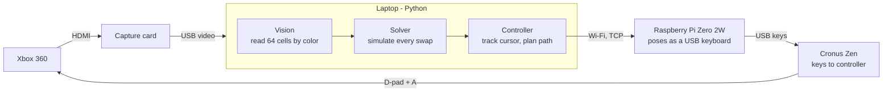

# Bejeweled Bot

A bot that played **Bejeweled 2 on an Xbox 360** through all 280 levels of Endless mode, unattended, over roughly 200 hours.

It doesn't modify the game or the console. The bot watches the TV picture through a capture card, reads the board with computer vision, chooses a move, and presses the buttons through a Raspberry Pi that poses as a USB keyboard.

**Write-up and interactive demo:** [harrisonkeyser.fun/bejeweled-bot](https://harrisonkeyser.fun/bejeweled-bot)

## Why

Beating Endless mode takes about 200 hours. The Xbox 360 version's save system is unreliable: I lost my progress once around 150 hours in, and again around 50 hours into the second attempt. So I gave the next 200 hours to a machine.

## How it works



1. **See.** The capture app shows the game in a window. The bot screenshots it, cuts the board into 64 cells, and classifies each cell by counting pixels inside hand-tuned HSV color ranges (`vision.py`).
2. **Think.** It tries every legal swap on a copy of the board and simulates the result, including chain reactions, power-gem explosions and gravity, then picks the highest-scoring move (`solver.py`).
3. **Act.** The laptop sends commands like `UP` or `SWAP_LEFT` over Wi-Fi to the Pi. The Pi types them as arrow keys and Space, and the Cronus Zen turns those into D-pad and A-button presses (`controller.py`, `pi/listener.py`).
4. **Wait.** It watches until the board changes (the swap registered) and then until it stops changing (the cascade finished), and goes again (`bot.py`).

## Problems worth solving

**White gems vs. hypercubes.** In a single frame, a white gem and a hypercube look almost the same: bright and mostly colorless. The difference is that a hypercube's rim cycles through colors. The bot keeps the last 8 readings for each cell, and a cell whose confidence jumps around (standard deviation ≥ 0.07) is a hypercube. White gems that are still falling also "flicker", so before using a hypercube the bot pauses, clears the history, and re-reads the still board to confirm it.

**Knowing where the cursor is.** The in-game cursor is too faint to find reliably on screen, so the bot tracks it by dead reckoning. The board doesn't wrap around, so seven presses down and seven left always land in the bottom-left corner. That gives a known starting point whenever the bot loses track.

**Detecting a lost cursor.** If the cursor drifts (for example when a press gets dropped), the swaps miss and the board doesn't change, so the bot keeps choosing the same move. Three identical attempts in a row trigger a cursor reset.

**Three seconds of video delay.** The capture card, from around 2012, lags about 3 seconds behind the console, so fixed timers either wasted time or acted on stale frames. The loop is closed instead: act, wait until the board changes, then wait until it reads the same twice in a row with no empty cells.

**Power gems that doubt themselves.** Power gems pulse, which drags their color confidence down. At one point the only legal move on the board was a low-confidence power gem, so the bot ignored it and stalled. Their center stays a bright, saturated version of their color, so a strong center now restores full confidence.

**Button timing.** Holding a direction for 0.3 s sometimes moved the cursor two cells; 0.2 s was reliable.

The result was about 250,000 points per hour, a little slower than a strong human. Nearly all of the gap comes from the capture card's delay.

## What you need

- An Xbox 360 with Bejeweled 2 (any console where a keyboard can drive the controller should work with small changes)
- A capture card whose app shows the game in a window on a **Windows** PC (I used an Elgato Game Capture HD)
- A [Raspberry Pi Zero 2W](https://www.raspberrypi.com/products/raspberry-pi-zero-2-w/), a micro-USB **data** cable, and a power supply
- A [Cronus Zen](https://cronus.shop/) (or another adapter that lets a USB keyboard act as the controller), with arrow keys mapped to the D-pad and Space to A
- Python 3.11+ on the PC

## Setup

### 1. The Pi (the hands)

Flash **Raspberry Pi OS Lite** with Raspberry Pi Imager. In the Imager's settings, set a username and password, enter your Wi-Fi, and enable SSH. Then, on the Pi:

```bash
sudo apt install -y git
git clone https://github.com/HarrisonKeyser/bejeweled-bot.git
cd bejeweled-bot/pi
sudo ./install.sh
sudo poweroff
```

Move the cable to the Pi's **USB** port (the data port, nearer the middle, not `PWR`) and plug it into the Cronus Zen. The Pi boots as a keyboard and starts listening. Note its address with `hostname -I`.

### 2. The PC (the eyes and brain)

```bash
git clone https://github.com/HarrisonKeyser/bejeweled-bot.git
cd bejeweled-bot
python -m venv .venv
.venv\Scripts\activate
pip install -e .
copy config.example.toml config.toml
```

Put the Pi's address in `config.toml`. Run the commands below from this folder so they find it.

### 3. Line it up and test

```bash
bejeweled-bot test-connection   # the cursor should move in a small square
bejeweled-bot calibrate         # line the grid up with the board, press P, paste into config.toml
bejeweled-bot watch             # shows the move it would make, without pressing anything
```

If gems are misread, click them in the `calibrate` window to see their HSV values and adjust `GEM_HSV_RANGES` in `vision.py`.

### 4. Play

```bash
bejeweled-bot play
```

Start a game in Endless mode, then press **F1** to start or pause, **F3** if you moved the capture window, and **Esc** to quit. `--dry-run` logs the button presses instead of sending them.

Keep the capture window visible (not minimized), and set the PC not to sleep.

## Other commands

| Command | What it does |
| --- | --- |
| `bejeweled-bot analyze shot.png` | Reads a saved screenshot and prints the board and best move. `calibrate` saves screenshots with Space. |
| `bejeweled-bot watch --no-overlay` | Watch mode in the terminal only. |
| `bejeweled-bot -v play` | Shows debug messages. |

## Project layout

```
src/bejeweled_bot/
  vision.py      reading cells by color; hypercube flicker detection
  solver.py      move search and cascade simulation
  controller.py  sending commands to the Pi; cursor tracking
  bot.py         the play loop and its safety nets
  watch.py       watch mode (the original "advisor")
  calibrate.py   grid alignment and color sampling
  cli.py         the bejeweled-bot command
pi/
  install.sh                  sets up the Pi
  usb-keyboard-gadget.sh      makes the USB port act as a keyboard (/dev/hidg0)
  listener.py                 network commands to key presses
  *.service                   start both at boot
tests/           pytest suite (solver, vision, controller, play loop, Pi listener)
```

Run the tests with `pip install -e ".[dev]"` and then `pytest`.

## Limitations

- The color ranges and grid position are tuned for one capture card at 1080p. Other setups will need `calibrate`.
- Finding the capture window uses the Windows API. The rest is cross-platform.
- The solver is greedy: it picks the best move for the current board and doesn't plan ahead. That was enough, because Endless mode can't be lost.

## License

MIT. Bejeweled is a trademark of Electronic Arts. This project isn't affiliated with or endorsed by EA or PopCap.
